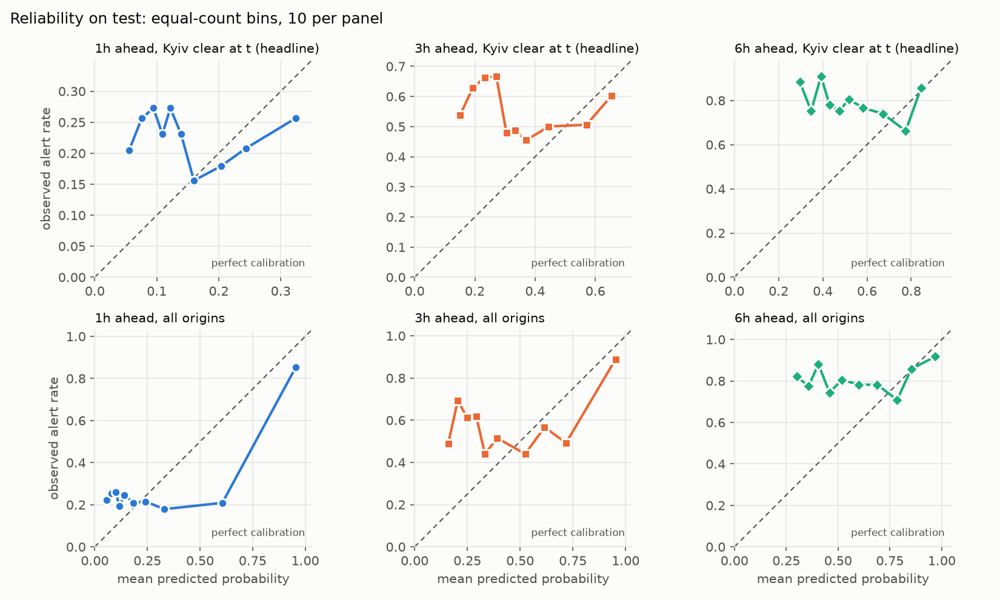
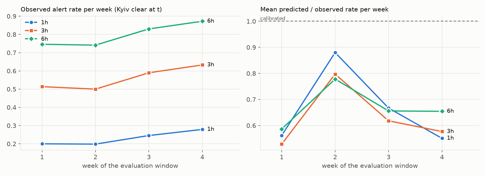

# AlertForecast

Probabilistic forecasting of air-raid alerts in **Kyiv city**: will an alert be active at any moment in the next
1, 3 or 6 hours? A mini pet-project in time-series analysis, built around one rule: **nothing the model is trained on
or uses as input may come from after the forecast time.**

## Headline result

**From alert history alone, I could not forecast a new Kyiv alert better than the base rate.** On the held-out test
window (28 days, 2026-09-14 to 2026-10-11, evaluated once):

- In the headline view, *Kyiv is clear at the forecast time*, the model's PR-AUC is indistinguishable from the base
  rate at every horizon (1h: 0.232 vs base rate 0.227; 3h: 0.551 vs 0.553; 6h: 0.784 vs 0.791), and no operating point
  I tried is meaningfully better than "always warn" (precision is within 0.007 of the base rate, and below it at recall 0.5).
- The model's probabilities are better than a time-of-day climatology (Brier and log loss, significant), but they
  **under-predict in every test week** (the mean prediction is 53-88% of the observed rate) and are significantly worse
  than a constant that knows the test window's own base rate.
- Where the model looks better (all origins, including ongoing alerts), most of the gain comes from knowing that an
  alert is already open.
- In the headline view, a simple 2-feature logistic baseline performs the same as the boosted model (no significant
  difference at any horizon).

That is a negative result, reported as such. Text and media (Telegram, news) were **not used**; see Limitations.

## The task

For every 30-minute forecast origin `t` (UTC), predict `P(an alert is active in Kyiv city in (t, t+h])` for
`h` in {1, 3, 6} hours. The label includes an alert that is already running at `t`, so every metric is reported in two views:

- **(a) All origins.** Inflated by ongoing alerts continuing.
- **(b) Kyiv clear at `t`** (as known at `t`). This is the headline view: forecasting a *new* alert.

Metrics: PR-AUC, Brier score (and skill vs climatology), log loss, precision and recall at frozen thresholds
(recall targets 0.5 / 0.8 main / 0.9), reliability curves, and weekly calibration drift. Confidence intervals use a
day-block bootstrap, because alerts cluster in time.

## Data

[`Vadimkin/ukrainian-air-raid-sirens-dataset`](https://github.com/Vadimkin/ukrainian-air-raid-sirens-dataset)
(files in its [`datasets/`](https://github.com/Vadimkin/ukrainian-air-raid-sirens-dataset/tree/main/datasets) folder),
volunteer file `volunteer_data_en.csv` (alerts collected from the eTryvoga channel), snapshot of 2026-10-12 05:05 UTC. The repo's official
file was unusable: it stopped in early September 2026 and has a feed failure on Aug 30 - Sep 1. The volunteer file
is the primary source **only because it is the only one covering validation and test**, not because it is known to
be more accurate. The raw data is not in this repo (`data/` is gitignored).

| Period | Kyiv alerts per day | Share with no end message ("naive") |
|---|---|---|
| Train (2022-03 to 2026-08-16) | 1.5 | 6% |
| Jun 22 - Aug 16 2026 | 2.2 | 24% |
| Validation (Aug 17 - Sep 13) | 4.5 | 18% |
| Test (Sep 14 - Oct 11) | 4.6 | 28% |

The validation and test windows sit in a **much busier regime** than most of the training data.

## Splits and leakage controls

Chronological only, Europe/Kyiv local days. Test 2026-09-14..10-11, validation 2026-08-17..09-13, train before that.

- **Strict per-horizon purge.** A fit row is kept only if `t + h` is strictly before the first evaluation origin.
- **Test lock.** The test split is unreachable in code unless `allow_test=True`, and the final script refuses to run twice.
- **Perturb-the-future tests.** Features at `t` and the labels of all fit rows must not change when everything after `t`
  is rewritten. The tests were validated by planting deliberate leaks, which they catch.
- **The `naive` flag is a leak, and I caught it.** The dataset writes `end = start + 30 min` only when the region's next
  alert comes more than 3 hours later, so a 30-minute duration reveals "no alert for 3 hours". Verified on the data
  (0 of 5,828 naive alerts have a next alert within 3h) and in the dataset's source code. Features and the
  clear-at-`t` state therefore use a **real-time view** in which a naive alert stays open until the next activation;
  the dataset's ends are used for labels only. This removed an inflated persistence baseline (PR-AUC 0.55 -> 0.31 at 1h
  on validation) and weakened the earlier neighbour-region signal.
- **Completeness cutoff.** The dataset writes an alert only when it closes, so alerts open at snapshot time are
  missing. Kyiv is complete only until 2026-10-11 22:10:32 UTC; test origins whose label window reaches past it are
  dropped (0 / 3 / 9 origins at 1h / 3h / 6h).

## Method

- **Features (real-time state only):** Kyiv-local hour and weekday, whether an alert is open and for how long, time since
  the last alert start and end, alert counts over 1/3/6/24h, share of time under alert over 6/24h.
- **Model:** scikit-learn `HistGradientBoostingClassifier`, fixed hyperparameters (no tuning), one model per horizon,
  fit on all rows purged before the evaluation start (train + validation for the test). No calibration.
- **Choices made on three 28-day windows, not just validation** (val, plus two earlier windows), with rules written
  into `CLAUDE.md` *before* running and applied as written:
  - recency weighting: rejected (significantly worse log loss; it follows the quieter regime the surge broke away from);
  - recent-rate features: neutral, rejected;
  - calibration (intercept shift, Platt, Platt with recency weights): none qualified (intercept shift was a near miss:
    better at 3h/6h, worse at 1h);
  - neighbouring-region alerts: not adopted (a hint at 1h only, inside the noise);
  - final model: the GBM, by the rule "logistic baseline unless the GBM's log-loss CI is below 0 at 2 of 3 horizons".
- **Operating thresholds** come from the pooled out-of-time predictions of the three 28-day blocks before the evaluation
  window, and are frozen before the test.

## Test results (single run)

Kyiv clear at `t` (headline view), n = 776 / 776 / 770 origins. 95% CIs from a day-block bootstrap (1,000 resamples).

| Horizon | Base rate | GBM PR-AUC | Climatology | Logistic baseline | GBM Brier | Brier of constant at test rate* |
|---|---|---|---|---|---|---|
| 1h | 0.227 | 0.232 [0.170, 0.311] | 0.209 | 0.201 | 0.188 | 0.175 |
| 3h | 0.553 | 0.551 [0.426, 0.686] | 0.488 | 0.511 | 0.318 | 0.247 |
| 6h | 0.791 | 0.784 [0.667, 0.878] | 0.724 | 0.771 | 0.270 | 0.165 |

\* Not deployable: it uses the test window's own base rate. It shows how much of the Brier score is lost to the
regime shift.

Paired differences, GBM minus other (day-block bootstrap, 95% CI), headline view:

| Comparison | 1h | 3h | 6h |
|---|---|---|---|
| PR-AUC vs climatology | +0.023 [-0.030, 0.085] | +0.062 [-0.044, 0.158] | +0.060 [-0.026, 0.119] |
| Brier vs climatology | -0.014 [-0.028, -0.004] | -0.079 [-0.132, -0.033] | -0.146 [-0.203, -0.093] |
| PR-AUC vs logistic baseline | +0.031 [-0.009, 0.084] | +0.040 [-0.029, 0.116] | +0.013 [-0.047, 0.072] |
| Log loss vs logistic baseline | +0.004 [-0.021, 0.026] | +0.013 [-0.052, 0.075] | -0.008 [-0.076, 0.058] |
| Brier vs constant at test rate* | +0.013 [0.006, 0.019] | +0.071 [0.044, 0.099] | +0.105 [0.071, 0.143] |

**Operating points** (thresholds from earlier blocks, applied to the test; achieved recall in brackets):

| Target recall | 1h precision | 3h precision | 6h precision |
|---|---|---|---|
| 0.5 | 0.218 (recall 0.61) | 0.519 (0.60) | 0.771 (0.70) |
| 0.8 (main) | 0.228 (0.89) | 0.553 (0.90) | 0.792 (0.95) |
| 0.9 | 0.231 (0.96) | 0.550 (0.95) | 0.798 (0.99) |
| *base rate* | *0.227* | *0.553* | *0.791* |

Precision is at most 0.007 above the base rate at recall 0.8 and 0.9 and below it at recall 0.5, so nothing here is
meaningfully better than warning at every origin. The frozen thresholds also did not transfer: at the 0.8 and 0.9
targets the achieved recall is 0.89-0.99, because the earlier blocks were quieter.

**All origins** (view a), n = 1,344 / 1,341 / 1,335: GBM PR-AUC 0.555 [0.497, 0.605] / 0.667 [0.594, 0.731] /
0.845 [0.784, 0.896] against base rates 0.284 / 0.576 / 0.807, persistence 0.327 / 0.590 / 0.817 and the logistic
baseline 0.311 / 0.572 / 0.814. Most of the gain over the baselines comes from knowing whether an alert is open (the
logistic baseline does not); at 3h and 6h the intervals of the GBM and persistence overlap, and I did not test that
difference. Even here the recall-0.8 operating point has precision 0.291 / 0.585 / 0.813, about the base rate.

**Calibration.** The model under-predicts the alert rate in every week of the test (mean prediction / observed rate
0.55-0.88 at 1h, 0.53-0.80 at 3h, 0.59-0.78 at 6h in the headline view), and its reliability curves in that view are
flat or non-monotone:





**Sensitivity to the naive alerts.** Dropping origins whose label window touches an alert with an imputed end (5-25%
of origins at 1h-6h in the headline view) changes the numbers but not the conclusion: PR-AUC 0.191 vs base rate 0.185
at 1h, 0.471 vs 0.477 at 3h, 0.708 vs 0.720 at 6h.

All tables are in `reports/` (`test_*.csv`, `phase3_*.csv`, `phase2_*.csv`).

## Limitations

1. **The headline is a null result.** In the clear-at-`t` view there is no demonstrated ranking skill above the base
   rate. The model is better than climatology only in Brier and log loss, mainly through its level.
2. **One 28-day test window in one regime.** Confidence intervals are wide, treat days as independent blocks, and
   describe this window only. Weekly behaviour varied (see the drift plot).
3. **A single, unverified label source.** The volunteer file has no ground truth behind it. About 28% of the test
   window's Kyiv alerts have an imputed 30-minute end (no end message), so labels near them are noisy, and a real
   alert may have lasted longer. The earlier source comparison found large disagreements, partly from the official
   file's outage. A cross-check against the alerts.in.ua API was deferred and not done.
4. **Missing recent data.** The file contains only closed alerts. Labels for the last hours before the snapshot can
   change when the file is refreshed, and the final test origins were cut for that reason. When an open alert is
   overwritten by a new activation within 3 hours, the earlier start is lost, so start times can be late.
5. **Regime shift.** Alert frequency tripled in August-September 2026 compared with the training average. All models
   under-predict, and calibration methods fit on earlier blocks cannot anticipate a jump. No calibrator was adopted.
6. **No text or media.** The task named news and Telegram as an advantage under the same no-leakage rule. I skipped
   that phase, so the project does not use it. Given the weak signal from alert history alone, I expect this to be
   where any real gain would come from, but I have not tested it.
7. **Little tuning, fixed model.** Hyperparameters were fixed, the feature set is small, and the model is not retrained
   during the 28 test days. A production system would retrain and could do better than this.
8. **Operating thresholds do not transfer** across regimes (see above). A deployed system would need drift-aware
   thresholds.
9. **Selection effects.** Methods were chosen on three windows with pre-registered rules and many comparisons
   (7 + 3 + 1 + 1 per horizon). None of the rules was changed after seeing results, and the test was run once, but
   the choice of GBM over the logistic baseline did not matter on the test (no significant difference).
10. **Provenance.** The test run used commit `15b25a3` plus a few uncommitted changes, recorded with a code hash in
    `reports/.test_run_done`. Only Kyiv city is modelled (not Kyiv oblast).

## Reproducing

```bash
python3 -m venv .venv && .venv/bin/pip install -e ".[dev,report]"
# Put volunteer_data_en.csv from the upstream commit of 2026-10-12 05:05 UTC into
# data/raw/vadimkin_2026-10-12/ (later snapshots differ, including the end of the test window).
.venv/bin/python -I -m pytest -q                       # leakage and unit tests
.venv/bin/python -I scripts/phase1/base_rates.py       # base rates (train and validation only)
.venv/bin/python -I scripts/phase2/run_baselines.py    # baselines on validation
.venv/bin/python -I scripts/phase3/stage_a.py          # Stage A: recency weighting, recent-rate features
.venv/bin/python -I scripts/phase3/stage_b.py          # Stage B: calibration candidates
.venv/bin/python -I scripts/phase3/stage_c.py          # Stage C: neighbour-region features
.venv/bin/python -I scripts/phase3/final_model_choice.py  # GBM vs logistic baseline
.venv/bin/python -I scripts/phase5/run_test.py dry     # full pipeline on validation (no test data)
.venv/bin/python -I scripts/phase5/run_test.py test    # the single test run (refuses to run twice)
```

## Layout

- `src/alertforecast/`: alert state, labels, splits and purge, features, models, calibration, metrics.
- `tests/`: leakage, state, purge and metric tests.
- `scripts/`: phase 1 (data audit, base rates, lead times), phase 2 (baselines, naive-flag checks), phase 3 (model
  selection), phase 5 (the test run).
- `reports/`: all result tables and figures.
- `CLAUDE.md`: the full specification, decision rules and the log of every correction.
